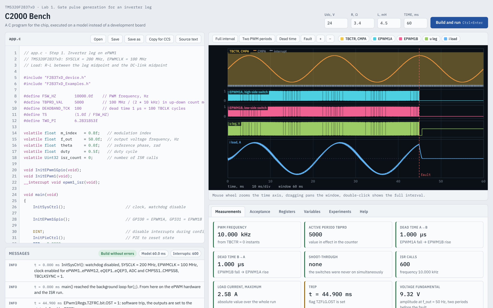
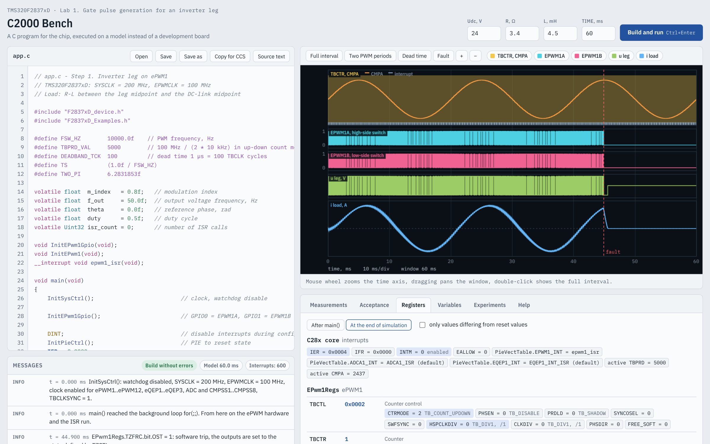
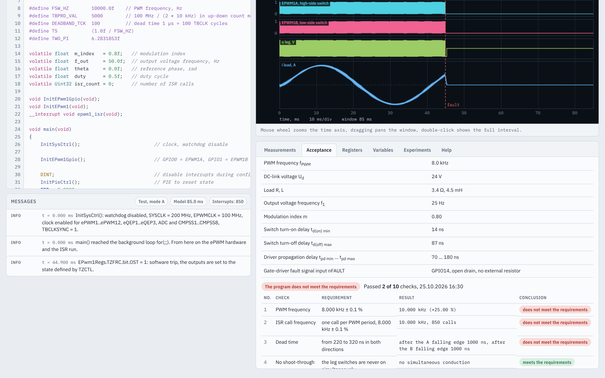

# C2000 Bench

**A register-level simulator of the TMS320F2837xD microcontroller with power-stage models, for teaching microcontroller programming of electric drives.**

Students write the same C code that runs on the chip, using the C2000Ware register structures (`EPwm1Regs.TBCTL.bit.CTRMODE = TB_COUNT_UPDOWN;`, `EALLOW`/`EDIS`, `InitSysCtrl()` …). The bench executes it on a model of the peripherals coupled with an inverter, a motor, sensors and a load. No development kit, no debug probe and no risk of destroying a converter. A cycle of ten laboratory works with automated acceptance tests is built in.



## Download

Ready-to-run Windows executables are in [`release/`](release):

| Edition | File | Notes |
|---|---|---|
| English | `release/C2000 Bench (English)/C2000 Bench.exe` | interface, messages, lab data, tests and program templates in English |
| Russian | `release/C2000 Bench (Russian)/Стенд C2000.exe` | original edition; also contains the built-in lecture slides for every lab (Russian) |

Both are single files that need no installation (Windows 10/11, 64-bit). The window opens in Microsoft Edge in application mode (Google Chrome is used if Edge is absent). The program works offline. On the first start Windows SmartScreen may warn that the program is unsigned: click *More info* → *Run anyway*. The two editions can run at the same time.

## What is modelled

**Microcontroller (TMS320F2837xD), at the level of registers and fields**, with reset values, shadow registers, write protection and clock enables:

- system control: `InitSysCtrl()` (SYSCLK 200 MHz, EPWMCLK 100 MHz), peripheral clock enables, watchdog;
- ePWM1–ePWM3: time base, counter compare, action qualifier, dead band, trip zone (one-shot and cycle-by-cycle), digital compare, event trigger, ADC start of conversion;
- ADC A: 12 bit, SOC0–SOC3 with acquisition window and trigger source, ADCINT1;
- eQEP1: quadrature decoder, index, position counter and latches, unit timer, capture unit;
- CMPSS1–CMPSS8: comparators with internal DACs, hysteresis, digital filters, latches;
- Input X-BAR and ePWM X-BAR, GPIO multiplexer, pull-ups and input qualification;
- PIE interrupt controller and the C28x interrupt registers (`IER`, `IFR`, `INTM`).

**Power stage and plant:** inverter leg with an R–L load, H-bridge with a DC motor, three-phase inverter with an induction motor driving a centrifugal pump, permanent magnet synchronous motor with an encoder and a load machine. Ideal switches with freewheeling diodes; shunt and Hall-effect current sensors with offset, gain error, limited bandwidth and noise; switching spikes at the comparator inputs; in the later labs the actual motor parameters differ from the datasheet values.

**Execution:** the C program (a subset of C with the C28x integer widths) is translated to JavaScript. `main()` runs at t = 0; then the model advances with a 10 ns step (one EPWMCLK period). The interrupt service routine runs atomically when the core accepts an interrupt.

## Debugging and error detection

- **Oscilloscope:** PWM counter and compare value with interrupt instants, gate signals, phase voltages and currents, the trip-zone input, the current-sensor output with the ADC sampling instants. Presets for two PWM periods, dead time and fault; zoom with the mouse wheel.
- **Registers tab:** every register of the modules in use, its value, purpose and fields with symbolic values from the header files (`CTRMODE = 2 TB_COUNT_UPDOWN`), optionally only the fields that differ from reset (an analogue of the CCS register window).
- **Variables tab:** global variables after `main()` and at the end of the run; a selected variable is recorded after every ISR call and drawn on the oscilloscope.
- **Measurements tab:** PWM frequency, dead time in both directions, ISR call count, shoot-through, trip time and more.
- **Messages** (info, warning, error) linked to the program lines. They report errors that are silent on the chip: writes to protected registers without `EALLOW`, writes to modules without clock, values that do not fit a field, interrupt flags not cleared, PIE group not acknowledged, ISR exit without `EDIS`, unset interrupt vectors, shoot-through of a leg, watchdog reset.



## Laboratory cycle

| Lab | Subject | Checks |
|---|---|---|
| 1 | Gate pulse generation for an inverter leg: ePWM, dead band, trip zone, ISR | 10 |
| 2 | Current measurement: ADC triggered by ePWM, shunt sensor, zero calibration, overcurrent trip | 11 |
| 3 | Current loop of a DC motor: H-bridge, unipolar PWM, PI controller with anti-windup | 15 |
| 4 | Speed loop of a DC motor: eQEP, M/T method, back-EMF compensation, cascade control | 14 |
| 5 | V/f control of a pump induction motor: three ePWM modules, space vector PWM, dead-time compensation | 10 |
| 6 | Field-oriented control of a PMSM: alignment, Clarke and Park transforms, current controllers | 10 |
| 7 | Position servo drive: trajectory generator, position and speed loops, feedforward | 10 |
| 8 | Identification of PMSM parameters and automatic tuning of the controllers | 10 |
| 9 | Hardware overcurrent protection on CMPSS comparators, X-BAR, digital compare | 10 |
| 10 | Complete acceptance testing of the servo drive | 10 |

Every lab has 30 variants of initial data and a program template with numbered tasks (*Acceptance* tab → *Open template*). *Run acceptance tests* runs the test programme of the lab in several modes (for example nominal operation with noise at the fault input, overmodulation, a gate-driver fault pulse, a load step, a phase short circuit) and gives a verdict for every check. *Save test report* stores an HTML report with the variant data, all results and the full text of the tested program with its SHA-256 checksum.



The laboratory manuals (theory, procedure, test programme, variants) are published separately in Russian. Reference solutions and variant keys are kept by the instructors and are not part of this repository.

## Transfer to the chip

Programs are written for the C2000Ware header files (`F2837xD_device.h`, `F2837xD_Examples.h`). *Copy for CCS* puts the program on the clipboard; add `F2837xD_SysCtrl.c`, `F2837xD_PieCtrl.c`, `F2837xD_PieVect.c`, `F2837xD_DefaultISR.c`, `F2837xD_GlobalVariableDefs.c`, `F2837xD_CodeStartBranch.asm`, `F2837xD_usDelay.asm` and the linker command files to a Code Composer Studio project. Check the ePWM outputs and the protections with the DC link disconnected before applying power.

## Limitations

Not modelled: execution time of the ISR and CPU load; ePWM4 and higher, CMPB, HRPWM, phase synchronization; ADC B–D, oversampling; the second core, CLA, DMA, CPU timers and communication interfaces; switching transients, losses and heating; magnetic saturation and slotting of the motors. Unsupported C features: `struct`/`union` declarations, `typedef`, pointers to variables, conditional compilation (`#if`, `#ifdef` are skipped with a warning). The bench confirms the configuration of the peripherals and the control algorithm; timing, real noise and power-up behaviour must be verified on hardware.

## Repository layout

```
release/                 ready-to-run executables (English and Russian)
src/simulator/           core.js       C translator, register-level MCU model, plant models
                         lab.js        labs: variants, test modes, checks, reports
                         page.html     user interface (editor, oscilloscope, tabs)
                         accept_ui.js  acceptance tab
                         template.c    initial program of step 1
                         templates/    program templates of Labs 1-10
src/windows/             Go shell: embeds the web page, serves it on 127.0.0.1, opens an app window
src/i18n/                extraction of user-visible strings and the English translation table
tools/build.py           builds both editions
docs/screenshots/        images used in this file
```

## Building

Requirements: Python 3.8+, Go 1.22+ (for the executables), optionally Node.js (icon and version information).

```
cd tools && npm install && cd ..     # optional: icon and version resources
python3 tools/build.py               # both editions into build/ru and build/en
python3 tools/build.py en            # English edition only
```

`build/<lang>/app/web/index.html` is a self-contained page that can also be served from any static web server. The English edition is produced from the same sources: `src/i18n/extract.py` finds every user-visible Russian string (string literals, HTML text, C comments of the templates), and `translations_en.json` replaces them; `code_fix.json` and `manual_fix.json` hold the few edits that depend on the language. After a change of the sources, strings without translation are listed by the build.

## How it was made

The simulator, the ten labs, their test programmes and the teaching materials were developed by the instructors in dialogue with the AI assistant Claude (Anthropic), working in an agentic environment that writes code, runs it and inspects the results. The instructors defined the content, the physical models, the typical student errors that the tests must catch and the requirements to the documents. Every change was verified by regression runs: each reference program must pass all checks on all 30 variants, and the reference program with an injected typical error must fail the checks intended for that error (78 of 79 injected errors are detected). Expert review of the generated engineering content remained necessary.

## Authors

Galina Demidova — Faculty of Control Systems and Robotics, ITMO University, Saint Petersburg.

## License

The source code and the materials of this repository are released under the [MIT License](LICENSE). The interface uses the IBM Plex fonts, distributed under the SIL Open Font License 1.1. TMS320, C2000, C2000Ware and Code Composer Studio are trademarks of Texas Instruments.
